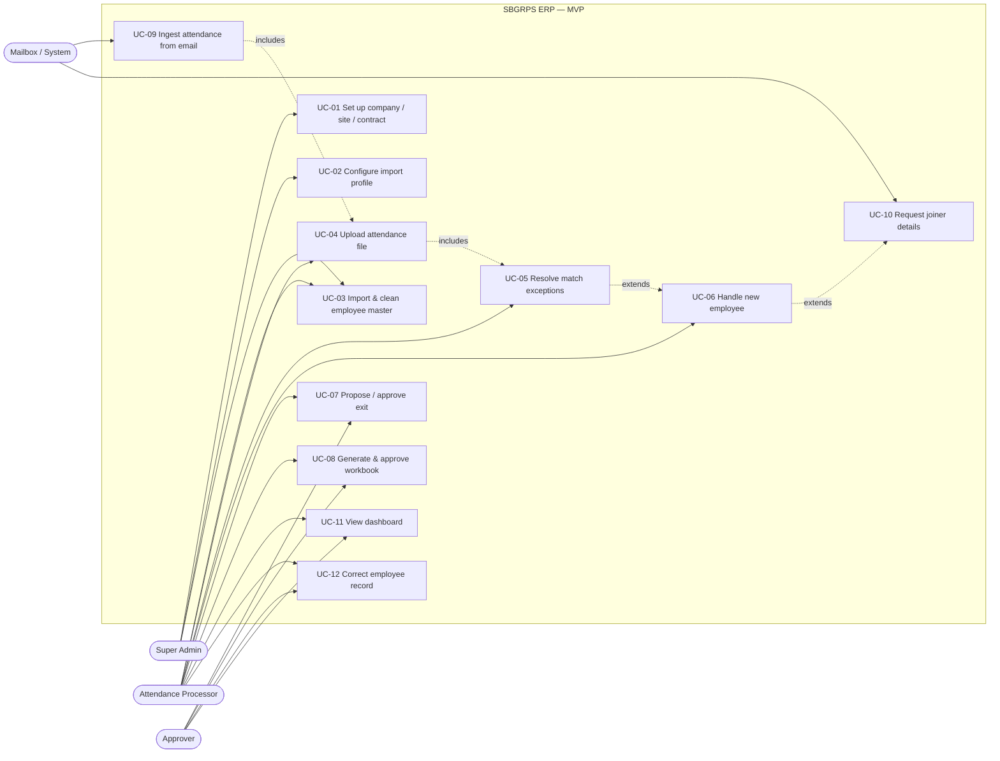
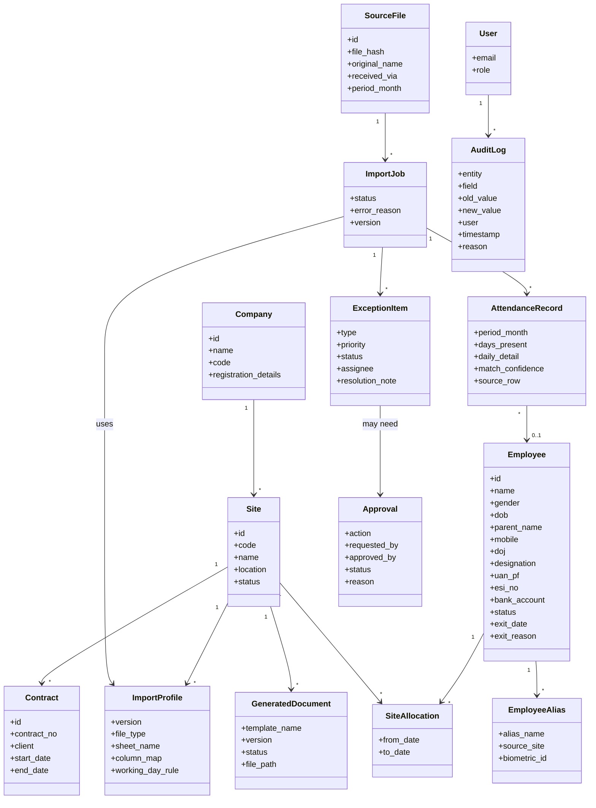
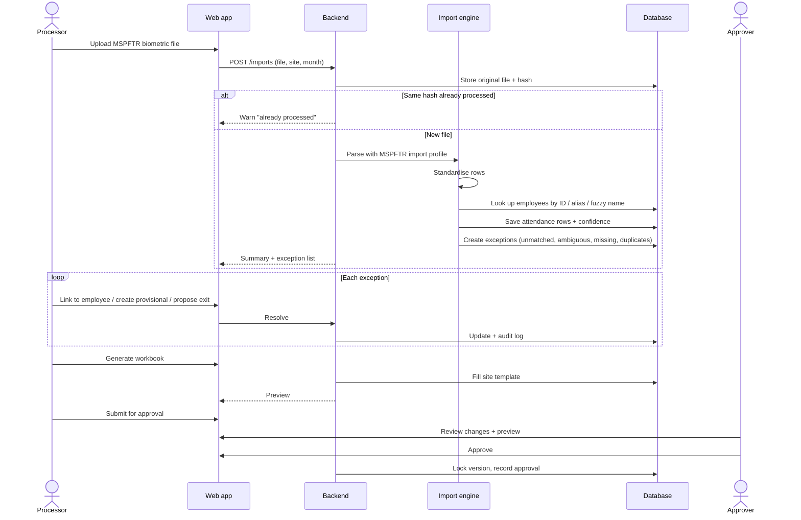
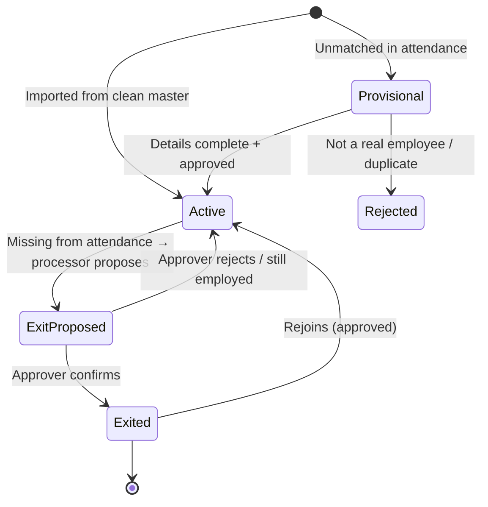
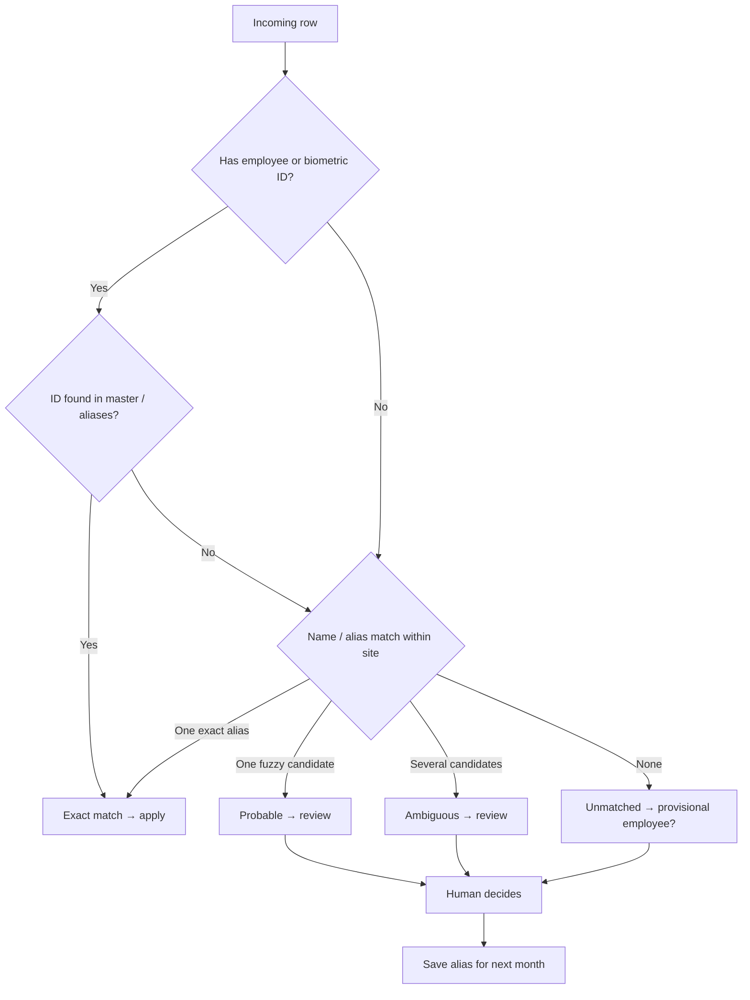

# SBGRPS ERP — UML diagrams (MVP)

**Version:** 0.1 · 2026-11-09 · Mermaid diagrams. They render on GitHub, in VS Code (Markdown Preview Mermaid extension) and at https://mermaid.live. Field lists will firm up after the sample files are reviewed.

## 1. Use-case diagram

## 2. Class diagram (core domain)

Enums: Site.status = Live / WaitingList / Closed · Employee.status = Provisional / Active / Exited · ImportJob.status = Received / Processing / AwaitingReview / Approved / Failed · AttendanceRecord.match_confidence = Exact / Probable / Ambiguous / Unmatched · GeneratedDocument.status = Draft / Approved / Submitted. Bank and ID numbers are stored encrypted.

## 3. Sequence: monthly attendance processing (MSPFTR)

## 4. State diagram: employee lifecycle

## 5. Activity: matching an incoming attendance row

