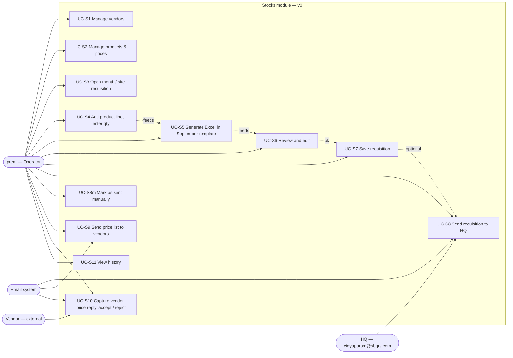
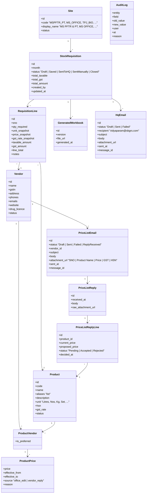
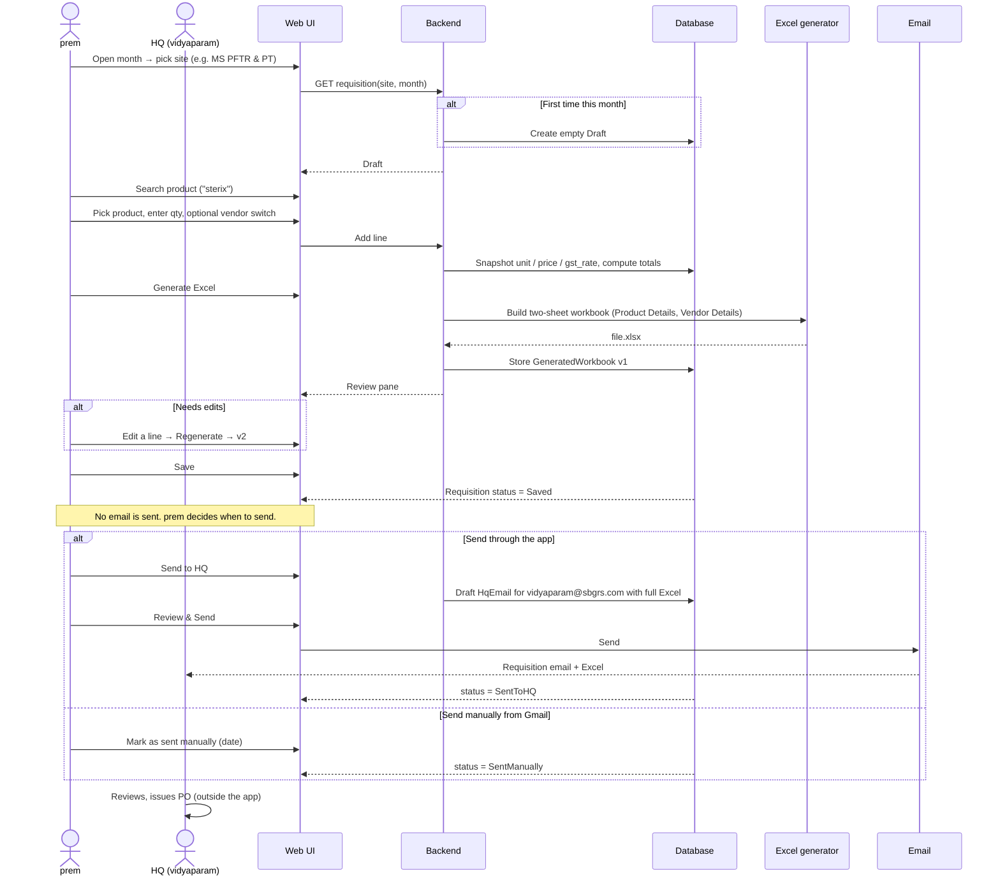
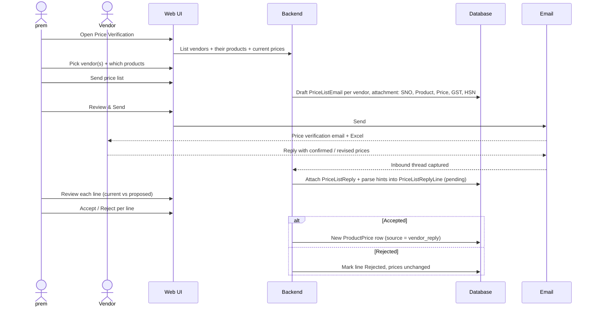
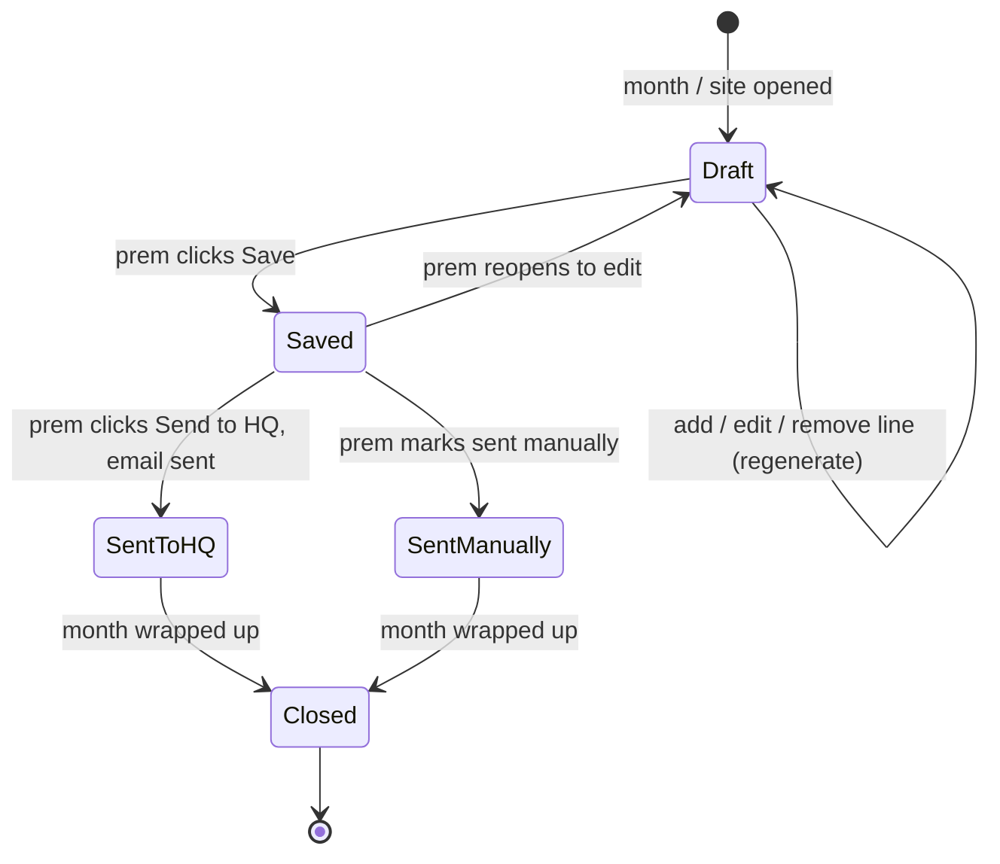
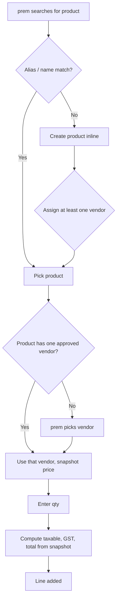
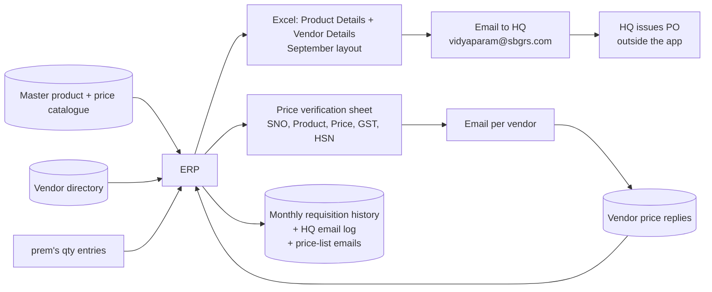

# SBGRPS ERP — Stocks module UML

**Version:** v0.3 · 2026-11-10 · Mermaid. Open in VS Code, GitHub or https://mermaid.live.

## 0. Where this fits

Single-user v0 — pre-release (prem does everything). Output is the September 2026 two-sheet layout: `Product Details` + `Vendor Details`. No Uniform sheet, no current-stock column. Save never sends. Two separate send flows: one to HQ (requisition Excel), one to vendors (price verification sheet). See [PRD-STOCKS.md](PRD-STOCKS.md).

## 1. Use-case diagram

## 2. Class diagram

> No `ProductVariant`, no `SiteProduct`, no `opening_stock`. prem ruled out uniform size breakdowns, per-site catalogues and current-stock entry for the MVP.

## 3. Sequence A: monthly requisition → Save → Send to HQ

## 3b. Sequence B: price verification to vendors

## 4. State diagram: StockRequisition

## 5. Activity: adding a line

## 6. Data flow (context)

